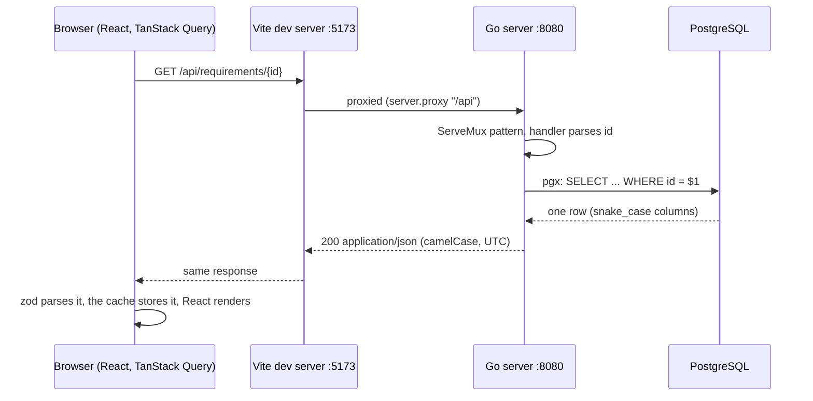

## Concept

TraceLite is a small requirements-traceability tool: projects contain a tree of
requirements, test cases verify requirements through trace links, and test runs record
results. It is built like StackLab itself, with one difference: the API is
**contract-first**.

- **PostgreSQL** holds the data and the rules a row can express (step 2).
- **One Go binary** (`cmd/tracelite`) serves `/api`: `httpapi` (routing, decoding,
  errors), the `tracelite` service (rules), `store` (sqlc queries, transactions). In
  production it also serves the built React app, so there is one origin (step 15).
- **A React app** built with Vite. In development Vite serves it on :5173 and forwards
  `/api` to the Go server on :8080.
- **`openapi.yaml`** in the repo root is the contract. It is written first. TypeScript
  types are generated from it; the Go wire types are written to match it and tested
  against it.

## Coming from C/C++/Java/Python/JS

- **Spring Boot + React**: the same split. springdoc usually generates the spec from the
  controllers (code-first); TraceLite writes the spec and checks the Go code against it.
- **Django + DRF**: serializers are both the wire format and the validation. Here the
  wire format is the spec, validation is the service, and the two are separate files.
- **Node full-stack (Next.js, tRPC)**: sharing TypeScript types between client and server
  makes the contract implicit. With a Go server the contract has to be a language-neutral
  file, which is also what lets any other client use the API.
- **C/C++**: a header shared by two programs, except that this one is checked at both
  ends: generated types at compile time, schemas at run time.

## How it works

The lifecycle of `GET /api/requirements/{id}`, which example 1 prints:



Where each name and type lives:

- **SQL** (`migrations/*.sql`): snake_case tables and columns, `uuid` ids, `timestamptz`.
- **Go store** (`internal/store`, generated by sqlc): structs per table, `uuid.UUID`,
  `*uuid.UUID` for nullable ids, `time.Time`.
- **Go wire types** (`internal/httpapi`): one struct per schema in `openapi.yaml`, the
  same names (`Requirement`, `RequirementCreate`, `Problem`), camelCase json tags.
- **TypeScript** (`web/src/api`): `schema.d.ts` generated from the spec, zod schemas that
  must satisfy it, branded ids (step 5).

The repository:

```text
openapi.yaml                 the contract
sqlc.yaml                    step 3
migrations/                  001_init.sql (step 2), then 002, 003, ...
queries/                     SQL for sqlc
cmd/tracelite/main.go        wiring: config, pool, migrate, store, service, router, server
internal/store/              generated queries + store.go (WithTx, errors)
internal/tracelite/          the service: rules shared by the API and the importer
internal/httpapi/            router, handlers, wire types, problems, cursors
web/                         Vite + React; vite.config.ts proxies /api in development
web/src/api/                 schema.d.ts, schemas.ts, client.ts, queries.ts (step 5)
```

The proxy, in `web/vite.config.ts`:

```ts
export default defineConfig({
  plugins: [react()],
  server: { proxy: { "/api": "http://127.0.0.1:8080" } },
});
```

The contract. This excerpt of `openapi.yaml` is canonical: later steps add their paths
and schemas next to these and follow the same patterns (step 4 lists every path).

```yaml
openapi: 3.1.0
info: { title: TraceLite, version: 0.1.0 }
paths:
  /api/projects/{projectId}/requirements:
    parameters: [{ $ref: "#/components/parameters/ProjectId" }]
    get:
      operationId: listRequirements
      parameters: [{ $ref: "#/components/parameters/Limit" }, { $ref: "#/components/parameters/Cursor" }]
      responses:
        "200":
          description: One page, ordered by code
          content: { application/json: { schema: { $ref: "#/components/schemas/RequirementPage" } } }
        "400": { $ref: "#/components/responses/Problem" }
        "404": { $ref: "#/components/responses/Problem" }
    post:
      operationId: createRequirement
      requestBody:
        required: true
        content: { application/json: { schema: { $ref: "#/components/schemas/RequirementCreate" } } }
      responses:
        "201":
          description: Created
          headers: { Location: { schema: { type: string } } }
          content: { application/json: { schema: { $ref: "#/components/schemas/Requirement" } } }
        "400": { $ref: "#/components/responses/Problem" }
        "404": { $ref: "#/components/responses/Problem" }
        "409": { $ref: "#/components/responses/Problem" }
        "422": { $ref: "#/components/responses/Problem" }
  /api/projects/{projectId}/requirement-tree:
    parameters: [{ $ref: "#/components/parameters/ProjectId" }]
    get:
      operationId: getRequirementTree
      responses:
        "200":
          description: Every requirement of the project, depth first
          content: { application/json: { schema: { $ref: "#/components/schemas/RequirementTree" } } }
        "404": { $ref: "#/components/responses/Problem" }
  /api/requirements/{requirementId}:
    parameters: [{ $ref: "#/components/parameters/RequirementId" }]
    get:
      operationId: getRequirement
      responses:
        "200": { description: The requirement, content: { application/json: { schema: { $ref: "#/components/schemas/Requirement" } } } }
        "404": { $ref: "#/components/responses/Problem" }
    patch:
      operationId: updateRequirement
      requestBody:
        required: true
        content: { application/json: { schema: { $ref: "#/components/schemas/RequirementPatch" } } }
      responses:
        "200": { description: Updated, content: { application/json: { schema: { $ref: "#/components/schemas/Requirement" } } } }
        "400": { $ref: "#/components/responses/Problem" }
        "404": { $ref: "#/components/responses/Problem" }
        "422": { $ref: "#/components/responses/Problem" }
    delete:
      operationId: deleteRequirement
      responses:
        "204": { description: Deleted }
        "404": { $ref: "#/components/responses/Problem" }
        "409": { $ref: "#/components/responses/Problem" }
  /api/requirements/{requirementId}/parent:
    parameters: [{ $ref: "#/components/parameters/RequirementId" }]
    put:
      operationId: moveRequirement
      requestBody:
        required: true
        content: { application/json: { schema: { $ref: "#/components/schemas/RequirementMove" } } }
      responses:
        "200": { description: Moved, content: { application/json: { schema: { $ref: "#/components/schemas/Requirement" } } } }
        "400": { $ref: "#/components/responses/Problem" }
        "404": { $ref: "#/components/responses/Problem" }
        "422": { $ref: "#/components/responses/Problem" }
components:
  parameters:
    ProjectId: { name: projectId, in: path, required: true, schema: { type: string, format: uuid } }
    RequirementId: { name: requirementId, in: path, required: true, schema: { type: string, format: uuid } }
    Limit: { name: limit, in: query, schema: { type: integer, minimum: 1, maximum: 200, default: 50 } }
    Cursor: { name: cursor, in: query, description: nextCursor of the previous page, schema: { type: string } }
  responses:
    Problem:
      description: An RFC 9457 problem
      content: { application/problem+json: { schema: { $ref: "#/components/schemas/Problem" } } }
  schemas:
    Project:
      type: object
      required: [id, name, createdAt]
      properties:
        id: { type: string, format: uuid }
        name: { type: string, minLength: 1, maxLength: 200 }
        createdAt: { type: string, format: date-time }
    Requirement:
      type: object
      required: [id, projectId, parentId, code, title, description, status, createdAt, updatedAt]
      properties:
        id: { type: string, format: uuid }
        projectId: { type: string, format: uuid }
        parentId: { type: [string, "null"], format: uuid }
        code: { $ref: "#/components/schemas/Code" }
        title: { type: string, minLength: 1, maxLength: 200 }
        description: { type: string }
        status: { type: string, enum: [draft, approved, obsolete] }
        createdAt: { type: string, format: date-time }
        updatedAt: { type: string, format: date-time }
    RequirementCreate:
      type: object
      required: [code, title]
      properties:
        code: { $ref: "#/components/schemas/Code" }
        title: { type: string, minLength: 1, maxLength: 200 }
        description: { type: string, default: "" }
        parentId: { type: [string, "null"], format: uuid, default: null }
    RequirementPatch:
      type: object
      minProperties: 1
      properties:
        title: { type: string, minLength: 1, maxLength: 200 }
        description: { type: string }
        status: { type: string, enum: [draft, approved, obsolete] }
    RequirementMove:
      type: object
      required: [parentId]
      properties:
        parentId: { type: [string, "null"], format: uuid }
    RequirementPage:
      type: object
      required: [items, nextCursor]
      properties:
        items: { type: array, items: { $ref: "#/components/schemas/Requirement" } }
        nextCursor: { type: [string, "null"] }
    RequirementTree:
      type: object
      required: [items]
      properties:
        items:
          type: array
          items:
            allOf:
              - { $ref: "#/components/schemas/Requirement" }
              - { type: object, required: [depth], properties: { depth: { type: integer, minimum: 0 } } }
    TestCase:
      type: object
      required: [id, projectId, code, title, description, createdAt, updatedAt]
      properties:
        id: { type: string, format: uuid }
        projectId: { type: string, format: uuid }
        code: { $ref: "#/components/schemas/Code" }
        title: { type: string, minLength: 1, maxLength: 200 }
        description: { type: string }
        createdAt: { type: string, format: date-time }
        updatedAt: { type: string, format: date-time }
    TraceLink:
      type: object
      required: [projectId, requirementId, testCaseId, createdAt]
      properties:
        projectId: { type: string, format: uuid }
        requirementId: { type: string, format: uuid }
        testCaseId: { type: string, format: uuid }
        createdAt: { type: string, format: date-time }
    TestRun:
      type: object
      required: [id, testCaseId, result, finishedAt, durationMs, notes]
      properties:
        id: { type: string, format: uuid }
        testCaseId: { type: string, format: uuid }
        result: { type: string, enum: [passed, failed, skipped] }
        finishedAt: { type: string, format: date-time }
        durationMs: { type: [integer, "null"], minimum: 0 }
        notes: { type: string }
    Code:
      type: string
      pattern: "^[A-Z][A-Z0-9]*(-[A-Z0-9]+)*$"
      maxLength: 40
    FieldError:
      type: object
      required: [pointer, detail]
      properties:
        pointer: { type: string, description: "JSON Pointer into the request body, e.g. #/code" }
        detail: { type: string }
    Problem:
      type: object
      required: [type, title, status]
      properties:
        type: { type: string, description: "about:blank or https://tracelite.example/problems/{validation|conflict}" }
        title: { type: string }
        status: { type: integer }
        detail: { type: string }
        errors: { type: array, items: { $ref: "#/components/schemas/FieldError" } }
```

Test cases, links and runs get the same operations under the paths step 4 lists, with
`TestCasePage`, `TraceLinkPage` and `TestRunPage` shaped like `RequirementPage`.

## Design notes

**Contract-first, with one generator.** The spec is written by hand and reviewed. The
TypeScript side is generated from it (openapi-typescript), because there the types are
the whole benefit. The Go side is written by hand in `internal/httpapi`, mirroring the
schema names, and a contract test checks the encoded output against the spec (example 2
shows the idea; step 14 makes it a test). The alternative, generating Go server code
with oapi-codegen, was rejected to keep sqlc the project's only Go generator and the
handlers ordinary `net/http` code that the HTTP lessons already taught.

**Naming.** SQL is snake_case because PostgreSQL folds unquoted identifiers to lower
case, and camelCase columns would need double quotes in every query. JSON is camelCase
because its main consumer is TypeScript, where camelCase members need no renaming. The
change happens once, in Go struct tags, and sqlc's column-to-field mapping
(`parent_id` to `ParentID`) is mechanical. Nothing in TypeScript renames members.

**Same origin everywhere.** Development uses the Vite proxy, production the Go binary
serving the built app; both mean relative URLs, no CORS headers and cookies that just
work. StackLab does the same with its own `vite.config.ts`.

**What this step doesn't decide.** Authentication (TraceLite is local and single-user,
like StackLab), deployment (step 15) and real-time updates (step 9) all slot into this
shape without changing it: a middleware, a build step, and one more endpoint.
