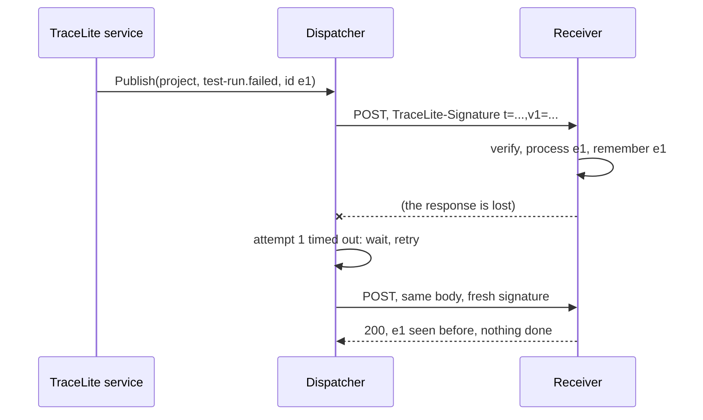

## Concept

TraceLite talks to two kinds of outside services, and is polite to both the same way:

- **A standards catalogue it calls.** Requirements cite clauses of standards
  (`ISO27001:A.5.17`). Step 6's detail view gains a lookup that shows a clause's title,
  fetched through `GET /api/standards/{ref}`, which calls the catalogue. The browser never
  calls it directly: that would need CORS, would expose any API key, and would bypass the
  cache.
- **Webhooks it calls on behalf of users.** A project can register URLs that receive a
  signed POST when a test run fails, so a CI system or a chat channel hears about it.

Politeness has the same four parts in both directions:

1. **Bound every call.** A deadline per attempt, derived from the caller's context, and a
   size limit on what is read back.
2. **Retry only what may go away**, and only operations that are safe to repeat: network
   errors, timeouts, 429 and 5xx. Wait with jittered backoff, or as long as Retry-After
   asks, but never past the caller's deadline.
3. **Remember answers.** A cache with expiry turns a daily-changing catalogue into a
   daily call, and a stale entry beats an error when the service is down.
4. **Make repeats harmless.** A retried webhook carries the same event id; receivers
   deduplicate on it. HMAC signatures prove the request came from TraceLite.

## Coming from C/C++/Java/Python/JS

- **Java**: Resilience4j's Retry, TimeLimiter and a Caffeine cache are these pieces as
  annotations and decorators. Here each is a few visible lines, and the deadline comes
  from the incoming request's `context.Context` instead of a thread-local.
- **Python**: `requests` without `timeout=` waits forever, like `http.DefaultClient`;
  `urllib3.Retry(backoff_factor=..., respect_retry_after_header=True)` is the loop of
  example 2.
- **JS**: `fetch` with `AbortSignal.timeout(2000)` is `context.WithTimeout`;
  `AbortSignal.any([request, timeout])` composes the two deadlines that Go derives by
  passing the context down.
- **C/C++ (libcurl)**: `CURLOPT_TIMEOUT_MS` per transfer plus your own retry loop; the
  shape is the same, the context that ties it to the caller's budget is not.

## How it works

The catalogue behind TraceLite's own endpoint:

```yaml
  /api/standards/{ref}:
    parameters: [{ name: ref, in: path, required: true, schema: { type: string, maxLength: 64 } }]
    get:
      operationId: getStandardClause
      responses:
        "200":
          description: The clause; stale is true when the catalogue was unreachable and the title comes from the cache
          content:
            application/json:
              schema:
                type: object
                required: [ref, title, stale]
                properties: { ref: { type: string }, title: { type: string }, stale: { type: boolean } }
        "404": { $ref: "#/components/responses/Problem" }   # the catalogue has no such clause
        "503": { $ref: "#/components/responses/Problem" }   # unreachable and nothing cached
```

The catalogue's URL and key come from configuration (`TRACELITE_STANDARDS_URL`), not from
the repo; the client is built once in `cmd/tracelite` and shared by every request.

Webhooks are registered per project, in `migrations/003_webhooks.sql`:

```sql
-- +goose Up
CREATE TABLE webhooks (
  id         uuid PRIMARY KEY DEFAULT uuidv7(),
  project_id uuid NOT NULL REFERENCES projects ON DELETE CASCADE,
  url        text NOT NULL CONSTRAINT webhooks_url_valid CHECK (url ~ '^https?://'),
  secret     text NOT NULL, -- the HMAC key; the receiver holds the same one
  events     text[] NOT NULL DEFAULT '{test-run.failed}'
               CONSTRAINT webhooks_events_valid CHECK (events <@ '{test-run.failed}'),
  created_at timestamptz NOT NULL DEFAULT now()
);
CREATE INDEX webhooks_project ON webhooks (project_id);
```

- The secret is stored in clear because TraceLite must compute HMACs with it; a hash
  would be useless. `events` lists the types a subscriber wants, constrained to the ones
  that exist, so a later type is added by replacing the CHECK. Deleting a project
  cascades to its webhooks.
- One event type so far, `test-run.failed`, published by the service after a failed run
  has been committed. Body: `{"id", "type", "createdAt", "data": {"projectId", "testCase",
  "requirements", "finishedAt"}}`, marshaled once (example 4).
- The dispatcher sends it to every webhook of the project that lists the type
  (`WHERE project_id = $1 AND $2 = ANY (events)`). Each POST is an attempt like example
  1's: its own timeout (10 s) derived from the caller's context, the shared client, and
  the response body read (bounded) and closed, because the Transport reuses a keep-alive
  connection only after the body was read to the end and closed.
- Header `TraceLite-Signature: t=<unix seconds>,v1=<hex HMAC-SHA256 of "<t>.<body>">`,
  computed for each attempt, and `Content-Type: application/json`. Receivers check the
  MAC and a five-minute window, and deduplicate on `id` (example 4).
- Responses: 2xx delivered. 410 Gone is the receiver saying "stop, for good", so the
  webhook is deleted (`DELETE FROM webhooks WHERE id = $1`). 429, 5xx and timeouts are
  retried with a loop like example 2's: delivery is at least once, since a timeout means
  "maybe processed". Any other 4xx stops this delivery: the receiver refused the request,
  and sending it again won't change its mind.



## Design notes

**Stale beats broken.** The clause title is decoration on the detail page; showing
yesterday's title with a "stale" flag is better than an error box. Data that must be
current (a payment status, a permission) would fail closed instead. The choice is per
call, and the `Stale` field makes it visible to the UI rather than hiding it.

**A circuit breaker, not yet.** When a dependency is down for minutes, every request
still spends its first attempt finding out. A circuit breaker would skip the call for a
while after repeated failures. With a cache that serves most lookups and a 2 s budget,
TraceLite doesn't need one; the retry and cache code is where one would go.

**Webhooks belong in the job table.** Step 10's dispatcher retries in memory for a few
seconds. Real receivers are down for hours, and TraceLite restarts. Step 11 turns each
delivery into a row in a job table, inserted in the same transaction as the failed run
(so a committed run always gets its webhook, an outbox), with `run_after` holding the
next retry time on a schedule of minutes to hours. The signing, the event id and the
status handling stay exactly as here.

**User-chosen URLs.** A webhook URL makes TraceLite's server send requests wherever a user
points it. On a single-user local install that is the user's own business; a shared
deployment must resolve the host and refuse loopback, private and link-local addresses
before connecting, or a webhook becomes a way to reach internal services.
