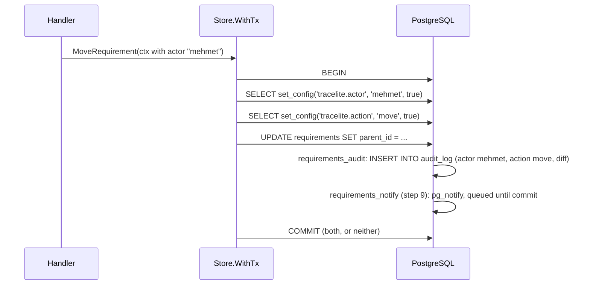

## Concept

The question "who changed this requirement, and what did it say before?" has two honest
answers.

**A database trigger** (migration 006). An `AFTER INSERT OR UPDATE OR DELETE … FOR EACH
ROW` trigger on `requirements`, `test_cases` and `trace_links` writes one `audit_log`
row per changed row, with the diff as jsonb. The database doesn't know TraceLite's
users, so the application tells it: the first statement of every transaction is
`set_config('tracelite.actor', $1, true)`, and the trigger reads it back with
`current_setting`.

**Application events.** The service writes a `change_events` row for each use case
(`requirement.moved`, `requirement.renamed`) in the same transaction as the change, with
the user it already knows and the data a person wants to read.

They fail differently:

| | Trigger | Application events |
|---|---|---|
| Writes through the service | yes, as diffs | yes, as named use cases |
| Rows removed by a foreign key's `ON DELETE CASCADE` | yes, each one | only what the use case names |
| psql fixes, bulk SQL, migrations' data fixes | yes, user shown as `db:<role>` | no |
| COPY, and step 7's import (COPY to staging, then INSERT … SELECT) | yes: COPY FROM fires row triggers | only if the importer writes one |
| DDL (`ADD COLUMN … DEFAULT`), `TRUNCATE` | no | no |
| Rolled-back transactions | no (rolled back with them) | no (same) |
| Intent ("moved under AUTH-LOGIN") | only if the service labels it | yes |

TraceLite keeps the trigger as the record of what happened, because a history that
misses whole categories of writes can't answer an auditor. It borrows the one strength
of events: the service may label a change (`set_config('tracelite.action', 'move',
true)`), and the trigger stores the label next to the diff.

## Coming from C/C++/Java/Python/JS

- **Java/Hibernate Envers, Spring Data auditing**: entity listeners write revisions,
  which is the application-events design generated for you. They see what goes through
  the ORM, and nothing else. `@CreatedBy` comes from an `AuditorAware` bean, usually
  reading Spring Security's thread-local context; here the user travels in the
  `context.Context` and then in the transaction.
- **Python/django-simple-history, Rails/PaperTrail**: same model, same blind spots
  (`queryset.update()` in Django skips save signals, `update_all` in Rails skips
  callbacks). A trigger can't be skipped by choosing a different API call.
- **JS/Prisma middleware or extensions**: the same again, per client instance.
- **Change data capture (Debezium, logical decoding)**: reads the WAL, so it sees
  every committed change, like the trigger, without slowing the writer. It runs as a
  separate service and still can't name the application user unless the application
  writes it somewhere: the same problem `set_config` solves here.

## How it works

`migrations/006_audit.sql` is example 1's middle part. The store side, in
`internal/store/store.go`:

```go
// WithTx: step 3's helper; the actor comes from the request's context.
return pgx.BeginFunc(ctx, s.db, func(tx pgx.Tx) error {
	if _, err := tx.Exec(ctx, "SELECT set_config('tracelite.actor', $1, true)", ActorFrom(ctx)); err != nil {
		return err
	}
	return fn(s.q.WithTx(tx))
})
```

`ActorFrom` reads what a middleware put into the request's context. In a single-user
local install that is the owner's name from configuration (step 15); with
authentication, the signed-in user. A use case that wants a label sets
`tracelite.action` the same way inside its closure (`move` for moves, `import` for step
7's importer).

Bulk loads need nothing extra. PostgreSQL's COPY reference says that `COPY FROM` invokes
the destination table's triggers and check constraints, so a pgx `CopyFrom` inside
`WithTx` is recorded row by row under the loading user. Step 7's importer copies into a
staging table and then runs `INSERT … SELECT` into `requirements`, which the trigger sees
like any other insert.

The history endpoint, in `openapi.yaml`:

```yaml
  /api/requirements/{requirementId}/history:
    parameters: [{ $ref: "#/components/parameters/RequirementId" }]
    get:
      operationId: getRequirementHistory
      parameters: [{ $ref: "#/components/parameters/Limit" }, { $ref: "#/components/parameters/Cursor" }]
      responses:
        "200":
          description: Newest first, keyset-paged by id
          content:
            application/json:
              schema:
                type: object
                required: [items, nextCursor]
                properties:
                  items:
                    type: array
                    items:
                      type: object
                      required: [at, actor, action, table, op, changes]
                      properties:
                        at: { type: string, format: date-time }
                        actor: { type: string }
                        action: { type: string }
                        table: { type: string, enum: [requirements, test_cases, trace_links] }
                        op: { type: string, enum: [INSERT, UPDATE, DELETE] }
                        changes: { type: object }   # the full row, or {column: [old, new]}
                  nextCursor: { type: [string, "null"] }
        "404": { $ref: "#/components/responses/Problem" }
```

It reads `audit_log` by `row_id` through `audit_log_row`, so it works for deleted
requirements too, as long as the client still has the id. The keys inside `changes` are
column names, snake_case, because they describe the table and not the wire format; the
detail page maps the few it shows (`title`, `status`, `parent_id`) to Turkish labels.



## Design notes

**Same choice as step 9, different weights.** Step 9 chose a trigger for change
notifications because every writer must notify, and a lost or extra notification costs
only a refetch. For the audit trail the "every writer" argument is stronger still (a
history with holes is worse than none, because it is believed), and the cost of the
trigger's weakness, missing intent, is softened by the action label. If TraceLite's
history were mainly a product feature ("Ayşe moved this under AUTH-LOGIN") rather than a
record, application events would win, and a trigger could still backstop them.

**Row triggers and bulk writes.** A row trigger costs one function call and one insert
per changed row. For TraceLite's imports (thousands of rows, rarely) that is acceptable.
At larger scale, statement-level triggers with transition tables (`REFERENCING OLD TABLE
AS … NEW TABLE AS …`) write the whole statement's audit rows in one `INSERT … SELECT`;
the price is one trigger per event, because a trigger with transition tables can't be
attached to several events at once.

**What the trigger can't stop.** A table owner can `ALTER TABLE … DISABLE TRIGGER`, and
`session_replication_role = replica` disables ordinary triggers for a session (it needs
superuser or a granted SET privilege). The application's role owns the tables (it runs
the migrations), so an attacker with its password could bypass the audit. A stricter
setup migrates with an owner role, runs the application as a role without ownership, and
grants it only INSERT on `audit_log`: then the application can't rewrite history either.
TraceLite, installed on one machine for one team, doesn't go that far; it says so in its
installation notes.

**Retention.** Audit rows are small, but they are never updated and rarely read.
Requirements change slowly enough that years of history fit easily; if a project ever
needed limits, a range partition per year (sql.modeling.temporal) lets old years be
detached and archived without a `DELETE`.
