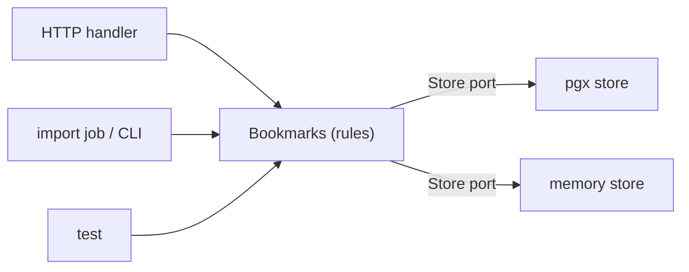

## Concept

Three shapes cover most Go services:

- **Flat**: HTTP handlers call a store (or run SQL) directly. Right for CRUD, admin
  tools and anything whose rules live in database constraints.
- **Layered**: a transport layer (decode, validate shape, map errors to statuses), a
  service layer (business rules, transactions, orchestration) and a storage layer
  (SQL). Each layer calls only the one below.
- **Ports and adapters** (hexagonal, Alistair Cockburn's term): a core of rules
  declares *ports*, interfaces for what it needs from the outside (storage, mail,
  clocks). *Adapters* implement them (a pgx store) or drive the core (an HTTP
  handler, a CLI, a queue consumer, a test). Dependencies point inward: the core
  imports neither `net/http` nor `pgx`.

In Go the step from layered to hexagonal is small. If the service declares the `Store`
interface it uses and the pgx package satisfies it, you already have a port and an
adapter. The real decisions are how many layers a feature gets, and what shape the
ports have.

Add structure when you can name what it buys: rules that aren't just validation, a
second entry point, tests that must run without a database, a transaction across
several statements. Without one of those, a layer is a pass-through, and a
pass-through is cost.

## Coming from C/C++/Java/Python/JS

- **Java/Spring**: `Controller -> Service -> Repository`, each with an interface and an
  `Impl`, is the default from the first endpoint. Go code usually starts flat, adds a
  service when a rule appears, and declares an interface only where a consumer needs
  a substitute.
- **Python**: Django puts rules on models (active record); FastAPI and Flask apps often
  stay flat with SQLAlchemy in the route. Both map directly onto the shapes above.
- **JS/TS**: NestJS enforces modules, controllers and providers; Express leaves it to
  you. Unlike a folder convention, a Go package boundary is enforced by the compiler:
  a core package without a `pgx` import cannot call pgx.
- **"Clean architecture"** adds more rings (entities, use cases, interface adapters),
  each with its own types. In Go that usually means mapping code nobody needs; take
  the dependency rule and skip the ceremony.

## How it works

Arrows are calls; the Go imports point the same way except at the ports: the pgx
store imports the core (for its types and errors), the core imports nothing from
it. `main` is the only package that sees both ends and connects them.

A port's shape decides where invariants live. A port mirroring a table (`Get`,
`Insert`, `Count`) leaves every rule that touches two rows to the service, which then
runs several statements without a shared transaction, as the third example shows. A
port shaped like the use case (`AddWithin`, `ReserveSeat`, `TransferFunds`) lets the
adapter run the whole thing in one transaction with the right locks, and keeps the
core free of transaction handles.

## Design notes

StackLab's backend is mostly flat, on purpose. `httpapi` handlers call
`*learningstore.Store` and `*runstore.Store` directly: one database, no rule beyond
what the schema enforces, nothing to swap. The run path is the
exception, and it is exactly where a port pays: `httpapi.Runner` has two adapters,
`runexec` in local mode and `runclient` in Docker mode, chosen in `main`. Every error
response leaves through one function, `httpapi`'s `problem` helper, so the error shape
stays uniform.

That mix is the recommendation. Choose a shape per feature, for the program you have:
flat until a rule, a second driver or a test without a database asks for more; a
service with use-case-shaped ports when it does. Moving from flat to layered later is
a mechanical refactor in Go (extract the rule, declare the interface where it is
called); undoing premature layers is harder, because every caller has learned them.
