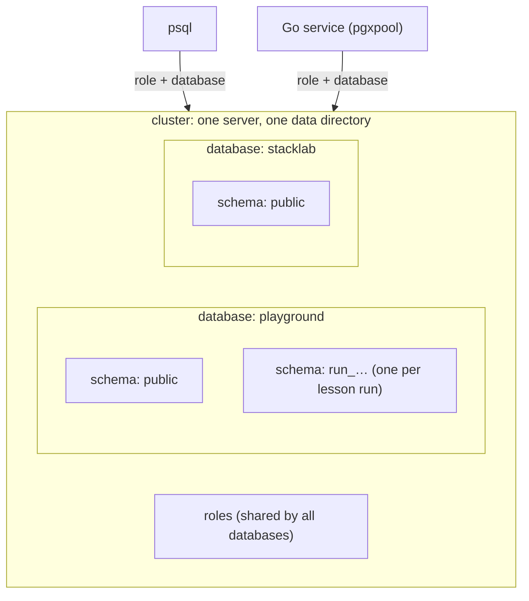

## Concept

PostgreSQL is a server program. Clients (psql, your Go service through pgx, a GUI) connect
to it over TCP or a local socket, and every connection names two things: a **role** to
log in as and a **database** to work in. The server starts a separate process for each
connection; that process holds your session's state (settings, the open transaction)
until you disconnect.

The containers, from the outside in:

- **Cluster**: one running server with its data directory, usually one port. The
  docs call it a "database cluster"; it has nothing to do with multi-node clustering.
- **Database**: an isolated collection of schemas. A connection is bound to exactly
  one, and no query can reach into another.
- **Schema**: a namespace inside a database, holding tables, views, functions, types
  and sequences. Schemas cannot nest, and joining across them is ordinary SQL.
- **Role**: a user, a group, or both. Roles live at the cluster level, next to the
  databases rather than inside them, so one role can own objects in many databases.

## Coming from C/C++/Java/Python/JS

- **MySQL**: `CREATE SCHEMA` is a synonym for `CREATE DATABASE` there, and you can join
  across them. That unit corresponds to a PostgreSQL *schema*. A PostgreSQL database is
  a much harder wall.
- **Go and Java packages, C++ namespaces**: a schema is the same idea: `billing.tickets`
  vs `support.tickets`, like `billing.Ticket` vs `support.Ticket`. `search_path` is like
  a list of C++ `using namespace` directives, except that where C++ reports an
  ambiguity, PostgreSQL silently takes the first match.
- **Python's `sys.path`** is a closer analogy still: an ordered search list that the
  environment can change under you. Code that must be robust qualifies its names.
- **Node and Go connection handling**: a connection is a server process, not a cheap
  socket. That's why `pgxpool` and `pg.Pool` exist, and why a `SET` on a pooled
  connection leaks into whichever request borrows it next.

## How it works

Name resolution happens when a statement is parsed. An unqualified `tickets` is looked
up in each schema on `search_path`, in order. `pg_catalog`, home of the built-in
functions and types, is searched first unless the path places it explicitly. The
default path is `"$user", public`: a schema named after your role if one exists, then
`public`. New objects without a prefix go into the first schema on the path that exists.

Every StackLab SQL run sits inside this picture: the runner connects as the
`playground` role to the `playground` database, creates schema `run_<id>`, sets the
path to it, runs your SQL in one transaction and rolls it back.

## Design notes

Choose the boundary by asking whether the data will ever be joined. Unrelated
applications get separate databases, and the docs recommend exactly that for projects
that should be unaware of each other. Parts of one application (core tables, an
audit trail, reporting views) get schemas in one database, so a report can join them
and one transaction can span them.

The PG 15 change to `public` is part of the same design: a database is owned by
someone, and by default only that owner may create objects in the shared schema. The
security module builds on this with a least-privilege application role. It is also why
StackLab's local setup makes the playground role the owner of its database instead of a
superuser: owning the database is enough to create schemas in it, and nothing more is
handed out.
