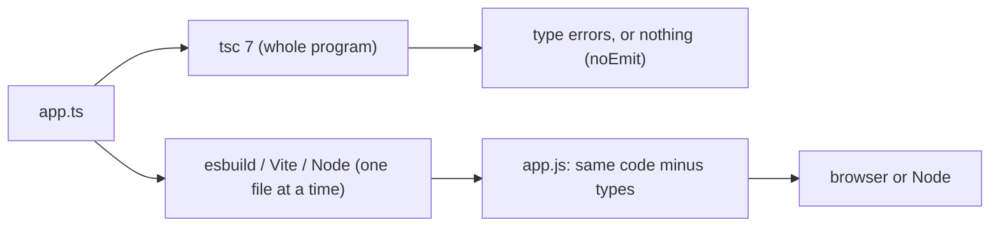

## Concept

TypeScript is JavaScript plus a layer of type syntax that is designed to be deleted. Two
different tools act on a `.ts` file, and they never talk to each other:

- The **checker**, `tsc`, reads the whole program (every file, every `.d.ts`), works out
  the types and reports errors. In a bundler project like this app it writes nothing:
  `npm run typecheck` is `tsc --noEmit -p tsconfig.app.json`.
- The **transpiler** (esbuild inside Vite, Node's type stripping, the esbuild-wasm worker
  behind this Run button) looks at one file at a time, removes the type syntax and hands
  JavaScript to the engine. It does not know or care whether the types are right.

So nothing about a type exists at run time: no reflection, no checks on assignment, no
`typeof SomeInterface`. A type is a claim that the checker verified, or (via `any`)
didn't.

**TypeScript 7.0** (July 2026) is the same language with the compiler ported to Go:
type-checking runs in parallel, and the 7.0 announcement measured full builds 8 to 12
times faster than the JavaScript-based compiler. tsc 7 can still emit JavaScript, and
like every tsc it emits even when there are errors unless `noEmitOnError` is set. The
bundler-plus-`noEmit` split is a project choice, not a limit of the compiler. What 7.0
does not ship is the old JavaScript compiler API, which is why this repo keeps
TypeScript 6.0 installed beside it for typescript-eslint (ADR-0006).

## Coming from C/C++/Java/Python/JS

- Python: the closest analogue. Type hints are ignored at run time and mypy/pyright is a
  separate checker. TypeScript works the same way, except that the hints are stripped
  out of the file instead of being kept in `__annotations__`.
- Java: you know generic type erasure. TypeScript erases *everything*: classes survive
  (they are JavaScript), but interfaces, type aliases, generics and annotations leave no
  trace, so there is nothing like `getClass()` or reflection over a declared type.
- C/C++: types drive code generation there (overload resolution, layout, templates).
  In TypeScript the types never change the emitted code, apart from the few
  non-erasable constructs in example 2.
- Go: `go build` refuses to produce a binary with a type error. Vite, Node and this
  runner happily run TypeScript that tsc rejects. The gate is your editor plus CI.
- JS: the runtime is exactly the one you know. Nothing new executes.

## How it works

Erasable syntax is what a per-file transpiler can delete without understanding it:
annotations, `interface`, `type`, generics, `as` casts, `import type`. A short list of
older TypeScript features generate code instead: `enum`, `namespace` with values, class
parameter properties and `import x = require(...)`. tsc also flags the old `<T>value`
assertion syntax under `erasableSyntaxOnly`. Node's built-in type stripping (on by default
since Node 23.6 and 22.18) refuses the code-generating constructs outright, and the
`erasableSyntaxOnly` flag (TypeScript 5.8) makes tsc report them as TS1294 so you learn
it in the editor rather than at startup.

`isolatedModules` (on in this repo's tsconfig) is the matching guard for the
transpiler's blindness: it makes tsc reject code that a one-file-at-a-time tool can't
transpile correctly, such as re-exporting a type without `export type`.

## Design notes

Treat the two tools as two jobs. The transpiler gives you a fast edit-run loop; the
checker is a test suite for your types and belongs in CI next to the unit tests
(`npm run typecheck` here). Write only erasable syntax (`erasableSyntaxOnly` plus
`verbatimModuleSyntax`), so the JavaScript that runs is exactly what you wrote minus
the types, and the same file works unchanged under esbuild, Node, Deno or Bun. Finally,
because types vanish, every value that enters as text (fetch bodies, `JSON.parse`,
storage, URL parameters) is `unknown` in reality, whatever its annotation says:
validate it once at the boundary, and inside the program trust the types.
