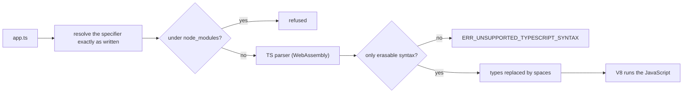

## Concept

`node app.ts` works. Since Node 23.6 and 22.18 type stripping is on by default, since
24.3 it no longer prints an experimental warning, and since 24.12 and 25.2 it is
marked stable. (It arrived behind `--experimental-strip-types` in 22.6.) Node parses
the file with a built-in TypeScript parser, replaces every piece of type syntax with
spaces, and hands the result to V8. That is all it does:

- **no type checking**: a file that tsc rejects still runs;
- **no tsconfig.json**: no `paths`, no `target` downleveling, no JSX;
- **no code generation**: only *erasable* syntax is accepted, meaning syntax that
  leaves valid JavaScript behind once it is blanked out.

The constructs that make the compiler generate code (`enum`, namespaces with values,
parameter properties, `import x = require()`) are refused with
`ERR_UNSUPPORTED_TYPESCRIPT_SYNTAX`, and so is the old `<T>value` assertion syntax. tsc
5.8's `erasableSyntaxOnly` flag rejects the same set at edit time (TS1294), so your
editor tells you before Node does.

Module rules follow from "no type information, no tsconfig": a `.ts` file is ESM or
CommonJS according to the nearest package.json `"type"` (`.mts` is always ESM, `.cts`
always CommonJS), import specifiers need their real extension, type-only imports need
`import type`, `.tsx` is unsupported, and Node refuses TypeScript files anywhere under
`node_modules`.

## Coming from C/C++/Java/Python/JS

- Go: `go run main.go` compiles and type-checks; one type error and nothing runs. Node is
  the opposite: it runs first, and the check is a separate `tsc --noEmit` you have to
  wire into CI.
- Python: the closest match. CPython ignores type hints and mypy checks them separately.
  The difference is that Python keeps annotations in `__annotations__` at run time, while
  Node deletes them.
- Java: `java Main.java` (the source launcher, Java 11) compiles in memory with full type
  checking. Node does no checking and keeps no class metadata.
- JS/Node: before this, running TS meant a build step or a loader such as ts-node or
  tsx. Those are still the answer for JSX, `paths` aliases or enums; for erasable code,
  plain `node` is enough.
- C/C++: think of a preprocessor that only blanks out text, never expands anything.

## How it works



Node's own docs recommend TypeScript 5.8 or newer with this tsconfig, and every flag
in it mirrors one runtime rule:

```json
{
  "compilerOptions": {
    "noEmit": true,
    "target": "esnext",
    "module": "nodenext",
    "rewriteRelativeImportExtensions": true,
    "erasableSyntaxOnly": true,
    "verbatimModuleSyntax": true
  }
}
```

- `erasableSyntaxOnly`: TS1294 on enum, value namespaces, parameter properties and `<T>x`.
- `verbatimModuleSyntax`: TS1484 when a type is imported without `type`.
- `module: nodenext`: TS2835 when a relative import has no extension.
- `rewriteRelativeImportExtensions` (TS 5.7): allows `./db.ts` specifiers, and rewrites
  them to `.js` if you ever compile instead of strip.

tsc 7.0.2 reports each of these codes for the snippets in example 2.

## Design notes

Running TypeScript directly splits the toolchain into two independent jobs. Node
executes, and tsc is your test suite for types. Keep `tsc --noEmit` in CI; without it
nothing ever checks the types. Write only erasable syntax even where a bundler would
accept more. The rule costs little (literal unions instead of enums, explicit fields
instead of parameter properties, modules instead of namespaces), and in return the same
file runs unchanged under Node, esbuild, Vite, Deno and Bun, and the JavaScript that
executes is your code minus its types. The boundary is publishing: a package on npm
still ships compiled `.js` plus `.d.ts`, because Node won't strip types inside
`node_modules` and consumers may run older Node versions.
