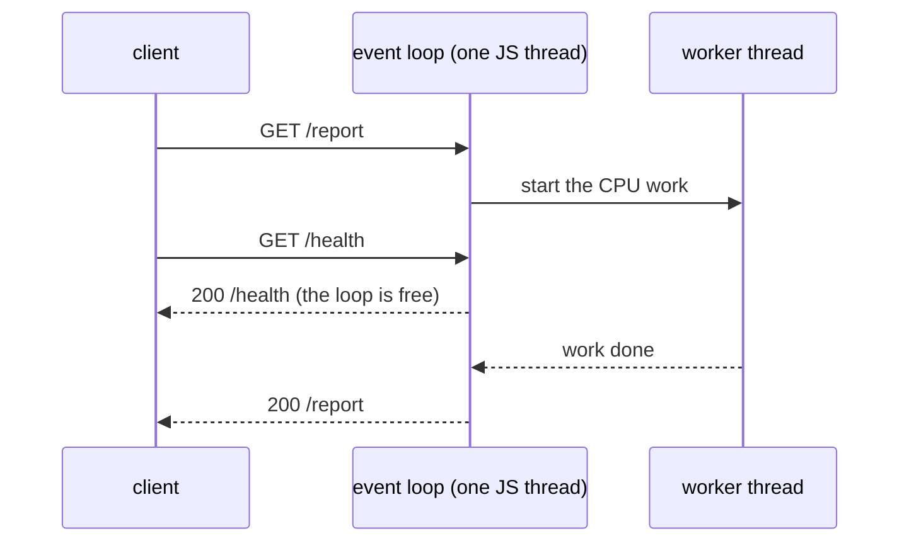

## Concept

Both programs from the Go track, rewritten for Node. The code reads much the same;
what sits underneath differs.

- **CLI**: `util.parseArgs` parses an explicit argument array (Go: a `FlagSet`),
  `readline` over `process.stdin` reads lines (Go: `bufio.Scanner` over `os.Stdin`),
  and the exit status is set on `process.exitCode`. Put the logic in a function that
  takes argv and streams, exactly as you would write `run(args, stdin, stdout)` in Go.
- **Server**: `http.createServer` takes one listener for every request. You route on
  `new URL(req.url, base).pathname`, decode path segments, set Content-Type and catch
  errors yourself; Go's `ServeMux` and `net/http` do more of that for you.

The **runtime model** is the real difference. A Go server gives every request its own
goroutine; goroutines run in parallel on all cores and are preempted. A Node server has
one JavaScript thread and an event loop: a handler runs until it returns or reaches an
`await`, and while it computes, nothing else in the process runs. Waiting is cheap and
computing is shared. CPU work goes to `worker_threads`.

## Coming from C/C++/Java/Python/JS

- Go: `flag` ↔ `parseArgs`; `os.Exit(2)` ↔ `process.exitCode = 2`;
  `http.HandlerFunc` ↔ the request listener; `r.PathValue` ↔ your own regex plus
  `decodeURIComponent`; `httptest.NewServer` ↔ `listen(0, "127.0.0.1")`;
  `Server.Shutdown` ↔ `server.close()`. Go recovers handler panics, while an async Node
  handler that throws takes the process down.
- Java: a servlet container runs requests on a thread pool, closer to Go. Node is like
  a single-threaded Netty event loop where your handler code runs on the loop itself.
- Python: asyncio with aiohttp is the same model as Node: one thread, cooperative
  `await`, and CPU work in a process or thread pool.
- C: a `select`/`epoll` loop with callbacks, minus the manual buffer management.
- JS: the browser's event loop, with sockets in place of DOM events. The rule you know
  from the UI (don't block the main thread) applies to every client of the server.

## How it works

The event loop runs one callback at a time: a request arriving, a timer firing, a
promise continuation. `await` ends the current callback and schedules the rest for
later, which is why the timer strategy in example 3 lets /health through. A worker
thread has its own V8 isolate and event loop. It shares no ordinary objects with
the main thread (only SharedArrayBuffer memory) and talks to it by messages (`postMessage`, or the
`exit` event used here), much like goroutines that share nothing and communicate
over a channel.

## Design notes

For a service that mostly waits on databases and other services, Node's model is
productive: one thread means no locks in handler code. Keep two rules. First, every
async handler needs a try/catch, or a framework that provides one, because an escaped
rejection ends the process. Second, CPU work above a few milliseconds per request
belongs in a worker or a job queue. If a service is CPU-bound, or needs many cores
without that bookkeeping, it is a good fit for Go, like this repo's own backend. For CLIs the choice comes down to distribution: Go ships one static
binary, while Node needs a runtime on the target machine but shares code and types with
the frontend. In both languages, write `main` as a function of argv and streams that
returns a status; that keeps the CLI testable.
