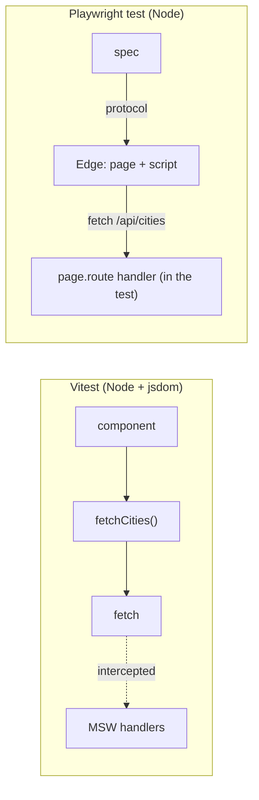

## Concept

Three tools, three boundaries:

- **MSW** (Mock Service Worker) mocks **the network**. You describe endpoints with
  handlers (`http.get(url, resolver)`); in Node, `setupServer` intercepts outgoing
  requests and answers them from the handlers. Your `fetch` code runs unchanged. See
  the [MSW docs](https://mswjs.io/docs).
- **Playwright** drives **a real browser** (here the installed Microsoft Edge,
  headless) through locators and auto-retrying assertions. `page.route` answers the
  browser's requests, the network mock one level up. See the
  [Playwright docs](https://playwright.dev/docs/intro).
- **Type tests** check **the types**. `expectTypeOf` from Vitest turns "this returns
  `Result<City[]>`" into an assertion that tsc verifies; files named `*.test-d.ts`
  are type-checked by `vitest --typecheck` and never executed. See Vitest's
  [testing types guide](https://vitest.dev/guide/testing-types).

A sensible split: many fast jsdom tests with MSW for components and clients, a
handful of Playwright tests for the flows that must work in a real browser, and type
tests for the types other code leans on.

## Coming from C/C++/Java/Python/JS

- Go: `httptest.NewServer` runs a real server on a loopback port, and your client
  must accept `srv.URL`. MSW intercepts in process: no port, no injected URL, but a
  patched global. Go has no type tests because the compiler is one; the closest idiom
  is a compile-time assertion such as `var _ io.Reader = (*MyReader)(nil)`, which is
  what `toExtend` expresses.
- Java: MSW sits between Mockito (replace the client) and WireMock (a real HTTP
  server); Playwright fills Selenium's role, with auto-waiting built in.
- Python: `responses` or `respx` patch the HTTP library much as MSW patches Node's;
  Playwright has Python bindings with the same API.
- JS: `jest.mock("axios")` and hand-made `fetch` stubs are the pattern MSW replaced.

## How it works

In Node, MSW hooks the modules that issue requests (the MSW README describes it as a
low-level interception algorithm, since Node has no Service Workers); in a browser it
registers a Service Worker. Playwright runs your test in Node and controls the browser
over a protocol; `page.route` pauses each matching request inside the browser and
lets the test continue, fulfill or abort it. For type tests, Vitest runs tsc with
`--noEmit` over the test files and maps each error to the `test()` block it falls in.
In this repo that is the `typescript` package (6.0); `npm run typecheck` uses 7.0.

## Design notes

Mock at the outermost boundary you can. The further out the mock sits, the more of
your real code each test covers: MSW keeps the client honest, and `page.route` keeps
the whole page honest. Keep handlers realistic (status codes, error bodies, Turkish
text in the payloads) and make unhandled requests fail. A mock that quietly lets a
request through, or answers everything with 200, gives you green tests that prove
nothing. Type tests earn their place on code with clever types: generic helpers, typed
clients, unions that callers narrow. If a type is simple enough that a reviewer sees
it at a glance, a type test adds nothing.
