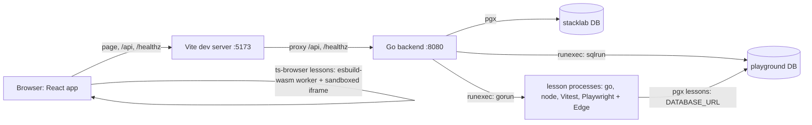
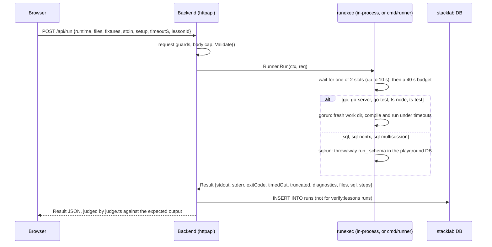
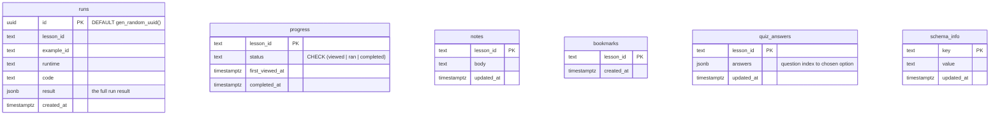

# StackLab architecture

A personal, local-only, single-user learning app: a Go backend, a React/TypeScript
frontend, PostgreSQL, and a runner that executes lesson code. No authentication; every
port is bound to 127.0.0.1. The decisions behind this shape are in `docs/adr/`; this
page shows how the parts fit together.

## Local mode (default, ADR-0008)

- `npm start` (`scripts/dev.mjs`) bundles the lesson libraries on first run, builds the
  backend to `.bin/stacklab.exe`, and runs it next to Vite on 127.0.0.1:5173. Ctrl+C
  stops both.
- Vite serves the frontend; the backend serves only the API and its health probes. Vite
  proxies `/api` and `/healthz` to 127.0.0.1:8080, so the browser stays same-origin and
  the backend sends no CORS headers. There is no embedded frontend and no mocksvc.
- One PostgreSQL 18 Windows service holds both databases, created by
  `scripts/setup-local-db.sql`: `stacklab` (app data, role `stacklab`) and `playground`
  (lesson SQL, the non-superuser role `playground`). Both use the builtin `C.UTF-8`
  locale; the playground keeps a real `LC_CTYPE` because pg_trgm still classifies
  letters through it.
- With `STACKLAB_RUNNER_URL` unset, the backend runs lessons in-process through
  `internal/runexec`. Configuration is environment variables only (`internal/config`),
  and the defaults are this setup, so local mode needs no `.env`.

## Docker mode (optional)

`make up` (from WSL2) starts six containers. The backend gets
`STACKLAB_RUNNER_URL=http://runner:8090` and sends runs through `internal/runclient` to
`cmd/runner`, an HTTP shell around the same `runexec`, so both modes share every runtime.

| Service | Purpose | Networks |
|---|---|---|
| `app-db` | App data | `backend-net` |
| `playground-db` | Lesson SQL | `runner-net` |
| `backend` | The Go API (`cmd/stacklab`) | `default`, `backend-net`, `runner-net` |
| `frontend` | Vite dev server, proxying to `backend:8080` | `default` |
| `runner` | `cmd/runner`: read-only root FS, uid 65532, 512 MB, 1 CPU, 128 pids (ADR-0003) | `runner-net`, `backend-net` |
| `mocksvc` | A health endpoint only; nothing calls it yet | `runner-net`, `backend-net` |

`backend-net` and `runner-net` are internal networks with no internet access. Docker mode
hasn't been re-tested since ADR-0008..0011 (open items in CLAUDE.md's backlog), and the
library lessons (pgx, x/sync, x/text, ts-test) are local-only by design (ADR-0010).

## The Run button

| Runtime | Runs in | What happens |
|---|---|---|
| `go`, `go-server` | gorun | `go build`, then the binary. Standard library, or pgx / x/sync / x/text built offline against a checked-in module template (ADR-0010) |
| `go-test` | gorun | `go test -v` over one `_test.go` file |
| `ts-node` | gorun | `node` with type stripping |
| `ts-test` | gorun, local only | Vitest (jsdom, Testing Library, MSW, `--typecheck`) or Playwright driving the installed Edge, in `.lesson-runs/` so the app's `node_modules` resolve |
| `sql` | sqlrun | one transaction in a `run_` schema, rolled back |
| `sql-nontx` | sqlrun | autocommit; the schema is dropped afterwards |
| `sql-multisession` | sqlrun | two sessions; a step still running after 400 ms is reported as waiting |
| `ts-browser` | the browser | esbuild-wasm in a Web Worker, then an ES module in `<iframe sandbox="allow-scripts">` |

- **gorun** gives each run a fresh work directory. A Go build gets 20 s; a `go` or
  `ts-node` program runs 5 s by default and up to 15 s (`timeoutS`), a `ts-test` run
  15 s at most (`timeoutS` lowers it). A `go-test` run gets the 20 s build allowance plus
  its test budget (`timeoutS`, 15 s by default), passed as `go test -timeout` so a hung
  test ends in Go's own panic; the outer kill comes 3 s after both. Each output stream is
  capped at 64 KB with a visible marker, cut on a UTF-8 character boundary. When a run or
  a build step ends, however it ends, the whole process tree is killed: a process group
  on Unix, a Job Object on Windows (`proc_unix.go`, `proc_windows.go`). The Windows job is
  kill-on-close, so a backend crash ends the lesson's processes too; on Linux `Pdeathsig`
  covers the direct child only (`proc_linux.go`), and macOS has no equivalent.
- **sqlrun** runs statements one at a time on pgx's simple protocol, as psql does, and
  renders results as text (ADR-0009). Its splitter keeps SQL-standard `BEGIN ATOMIC …
  END` routine bodies whole, following psql's rule. Every statement is bounded by `statement_timeout`
  and `lock_timeout`; `guard.go` refuses statements that would end the `sql` sandbox's
  transaction, and `COPY ... FROM STDIN` everywhere. A Go lesson that imports pgx gets
  its own `run_` schema through `DATABASE_URL`. The modes that commit (`sql-nontx`,
  `sql-multisession`, pgx lessons) first drop any `run_` schema older than 10 minutes
  that a crashed run left behind.
- **ts-browser** never reaches the backend. The iframe has an opaque origin and a CSP
  with no network access; console output comes back by `postMessage`. All its scripts sit
  in `<head>` (the body starts empty): the shim, the lesson as a `data:` URL module, and a
  second module that `import()`s the same URL to learn when the lesson's module has
  finished or thrown. The run ends then, once no timer is pending; an uncaught error in a
  timer callback, a listener or an unhandled rejection is reported with exit 1 but doesn't
  end the run (`runner/browserTs.ts`, tested in `browserTs.test.ts`). Lessons that import react,
  react-dom, react-router-dom, @tanstack/react-query or zod get them from
  `public/lesson-libs` (`scripts/build-lesson-libs.mjs`) as `data:` URLs in an import
  map.

## Content pipeline (ADR-0004, ADR-0009)

- Lessons are files: `content/<track>/<module>/<NN-slug>/` with `lesson.md`,
  `examples/`, `expected/`, `fixtures/`. `content/curriculum.yaml` drives the sidebar
  and learning paths (`npm run gen:curriculum`).
- `scripts/build-lessons.mjs` (contentcheck) validates the frontmatter against
  `content/lesson.schema.json`, ids, prerequisites, files on disk, the fixed H2
  sections, official-only further reading and `LEARN(...)` markers, then generates the
  lesson data the frontend imports: `src/features/lessons/lessonIndex.generated.ts`
  (ids, titles, summaries and each lesson's unconfirmed claims) and one
  `src/features/lessons/generated/<id>.json` per lesson, rewritten only when it changes.
  `content/lessons.bundle.json` and `--out` keep the single-file format for
  `verify:lessons`. The backend never reads `content/`: lessons reach it only as run
  requests.
- `npm run verify:lessons` (with the app running) sends every server example through
  `POST /api/run` with `X-Stacklab-No-History`, runs ts-browser examples in headless
  Edge or Chrome on `verify.html`, and judges both with the UI's own `judge.ts`, twice.
- `<!-- VERIFY: ... -->` markers render as warnings in the lesson, and `/unverified`
  lists them all.

## Frontend

React with React Router (`/`, `/paths/:pathId`, `/tracks/:trackId`,
`/lessons/:lessonId`, `/unverified`), organized in feature folders under
`src/features/`: `curriculum`, `lessons`, `runner`, `learning`. No feature imports
another: shared pieces live in `src/shared/` (`API_BASE` in `shared/api.ts`), `app/`
composes the features, and `eslint.config.js` enforces it. Lesson and curriculum data
are generated files, never fetched from the backend: the dashboard, header and
`/unverified` render from the eager index, and a lesson's content is a lazy chunk loaded
by `lessons/load.ts` when it opens. Progress, notes, bookmarks and quiz answers go
through `learning/api.ts` and a small shared store (`learning/store.ts`); if `/healthz`
fails or answers with an error status, the same calls go to localStorage instead. The
run panel edits code in Monaco, bundled from the installed `monaco-editor` package and
lazy-loaded (`runner/CodeEditor.tsx`), so the app needs no network; it shows an
example's `setup` SQL, collapsed, and picks a runner per runtime
(`runner/CodeRunner.ts`).

## Backend

| Package | Role |
|---|---|
| `cmd/stacklab` | Wiring only: config, logger, pool, migrations, runner, router, server |
| `cmd/runner` | Docker only: `POST /run` around runexec |
| `cmd/mocksvc` | Docker only: a health endpoint |
| `internal/config` | Environment variables with local-mode defaults |
| `internal/platform` | pgx pool, slog logger, goose migrations embedded in the binary |
| `internal/httpapi` | Routes (`NewRouter`), middleware, request guards, problem+json errors, run and learning handlers |
| `internal/runapi` | Wire types shared by `/api/run` and the runner's `/run`; `Result.MarshalJSON` sends empty lists as `[]`, never `null` |
| `internal/runexec` | Runtime dispatch and the concurrency limit |
| `internal/runclient` | HTTP client for the runner container; passes the runner's refusal detail through and turns a runner 500 into a 502 |
| `internal/gorun` | Go, `go test`, Node, Vitest and Playwright processes |
| `internal/sqlrun` | The three SQL modes, statement splitting, guards, text output |
| `internal/runstore`, `internal/learningstore` | Hand-written pgx queries for run history (bounded to the newest 1000 runs, `runstore.DefaultKeep`) and learning state |

Routes: `GET /healthz`, `GET /readyz`, `POST /api/run`, and the learning endpoints under
`/api/progress`, `/api/notes`, `/api/bookmarks`, `/api/quiz` and `/api/history`. The
handler chain is logging → panic recovery → request guards (ADR-0011: cross-origin
protection, JSON-only bodies, a loopback `Host` on `/api/`) → problem fallbacks → mux.
Every error leaves as problem+json, including the mux's own 404 and 405 (with `Allow`)
and a recovered panic (500). The run handler lifts the write deadline while a run is
queued or running and sets a fresh one for the reply.

## Data model (stacklab DB)

Single user, so `lesson_id` is the key everywhere and there are no foreign keys: lessons
live in `content/`, not in the database. Migrations are append-only goose files in
`server/cmd/stacklab/migrations`, applied by the backend at startup.

## Key decisions

- ADR-0001: standard-library `ServeMux`, no web framework.
- ADR-0002: pgx + sqlc + goose, no ORM (sqlc was never adopted; see its update).
- ADR-0003: the runner container's sandbox and threat model (Docker mode).
- ADR-0004: lesson content as repo files (built into the frontend; see its update).
- ADR-0005: TanStack Query, no global state library (the app uses neither; see its
  update).
- ADR-0006: TypeScript 7 for type-checking, 6.0 alongside for typescript-eslint.
- ADR-0007: one Go module, `cmd/` + `internal/` by feature.
- ADR-0008: local mode, lessons run in the backend process.
- ADR-0009: every runtime implemented, every example verified by running it.
- ADR-0010: lessons may use real libraries (local mode).
- ADR-0011: request guards on the code-executing API.
